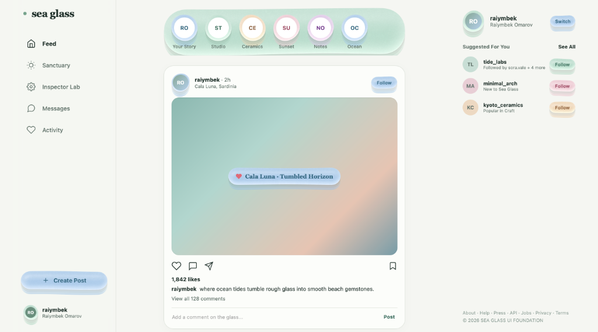
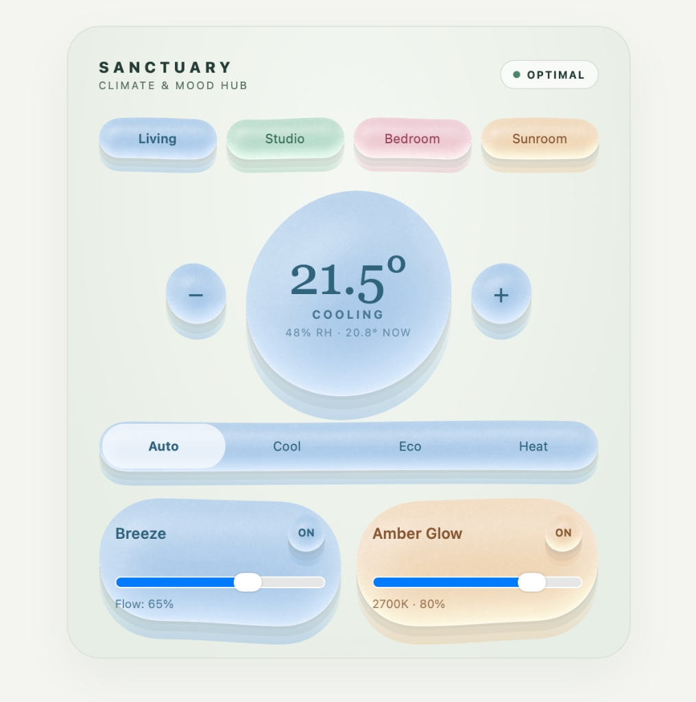
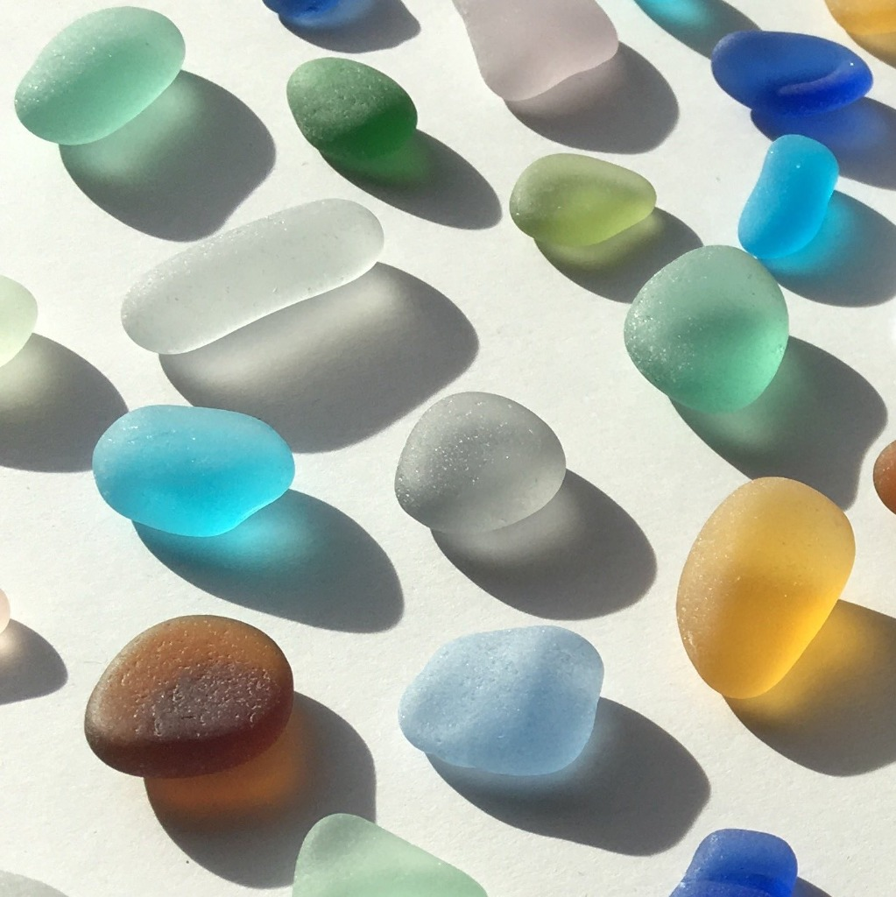

# Sea Glass — Universal Design Foundation & AI Skill

[](https://raimbek-pro.github.io/sea-glass-skill/instagram.html)
[](ios)
[](LICENSE)
[](https://central.sonatype.com/artifact/dev.mttmcknn/sea-glass/0.1.0)
[](SKILL.md)

> Frosted color, softly tumbled contours, and a little seaside whimsy — universally compatible across **Web (HTML/React/Vue)**, **iOS (Swift / SwiftUI)**, and **Android / Multiplatform (Compose)**.

<p align="center">
  
</p>

<p align="center">
  
  
</p>
<p align="center">
  <em>Physical beach glass optics (right) translated into live, tactile software interfaces (left & top).</em>
</p>

---

## 🌊 Live Interactive Web Demos

Explore the live responsive pages deployed directly with this repository:

* **[Instagram Web Experience](https://raimbek-pro.github.io/sea-glass-skill/instagram.html)** — Adaptive 3-column desktop layout, story halos, interactive heart toggles, and floating frosted post cards.
* **[Sanctuary Climate Hub](https://raimbek-pro.github.io/sea-glass-skill/sanctuary.html)** — Tactile circular thermostat dial, room zone pills, and live frosted slider controls.
* **[Material Inspector Lab](https://raimbek-pro.github.io/sea-glass-skill/)** — Tweak real-time Frost, Grain, Tumble, Bulge, and Elevation optics.

---

## 🤖 1. Install as an AI Skill (Use in ALL Your Projects)

Teach your AI coding assistant (Google Antigravity, Cursor, Claude Code, Gemini, or Copilot) to automatically design and write Sea Glass interfaces:

### Global Install (Available across all your projects on this machine)
```bash
git clone https://github.com/Raimbek-pro/sea-glass-skill.git ~/.gemini/config/skills/sea-glass
```

### Project-Level Install (Commit with your repository for teammates)
Copy `SKILL.md` into your project:
```bash
mkdir -p .agents/skills/sea-glass
cp path/to/SKILL.md .agents/skills/sea-glass/
```

Once installed, simply ask your AI:
> *"Design an audio player screen using Sea Glass style"*  
> *"Add frosted glass buttons with physical press depression to this page"*  
> *"Style my Compose cards with sea-glass mint palette and tumbled contours"*

---

## 🌐 2. Web Usage (HTML, Vanilla JS, React, Vue)

### Install via npm
```bash
npm install @raimbek-pro/sea-glass
```

### Mount under Any DOM Element
```javascript
import { mountGlass } from '@raimbek-pro/sea-glass';

const glass = mountGlass(document.getElementById('my-button'), {
  shape: 'capsule',   // 'rounded' | 'capsule' | 'disc'
  palette: 'mint',    // 'lagoon' | 'mint' | 'rose' | 'amber' | 'lilac'
  seed: 42,
  settings: {
    frost: 0.55,      // Cloudiness (0..1)
    grain: 0.48,      // Micro-abrasion roughness (0..1)
    tumble: 0.025,    // B-spline contour asymmetry (0..0.065)
    thickness: 6,     // Optical thickness (0..14px)
    bulge: 0.65,      // Center curvature (0..1)
    elevation: 8,     // Drop shadow lift (0..18px)
  }
});

// Update settings dynamically:
glass.update({ elevation: 3 });

// Cleanup:
glass.destroy();
```

### Declarative HTML Pattern
```html
<button class="glass" data-glass data-shape="capsule" data-palette="lagoon" data-seed="12">
  Follow
</button>
```

---

## 📱 3. Android & Compose Multiplatform Usage

### Gradle Setup
```kotlin
repositories {
    mavenCentral()
}

dependencies {
    implementation("dev.mttmcknn:sea-glass:0.1.0")
}
```

### Jetpack Compose Components
```kotlin
import androidx.compose.foundation.layout.padding
import androidx.compose.material3.Text
import androidx.compose.runtime.Composable
import androidx.compose.ui.Modifier
import androidx.compose.ui.unit.dp
import dev.mttmcknn.seaglass.SeaGlassButton
import dev.mttmcknn.seaglass.SeaGlassPalette
import dev.mttmcknn.seaglass.SeaGlassShape
import dev.mttmcknn.seaglass.SeaGlassSurface
import dev.mttmcknn.seaglass.seaGlass

// Modifier:
@Composable
fun FrostedBadge() {
    Text(
        "Tumbled Beach Glass",
        color = SeaGlassPalette.Lagoon.ink,
        modifier = Modifier
            .seaGlass(palette = SeaGlassPalette.Lagoon, shape = SeaGlassShape.Capsule)
            .padding(horizontal = 20.dp, vertical = 12.dp)
    )
}

// Tactile Button with physical press offset:
@Composable
fun LikeButton(onClick: () -> Unit) {
    SeaGlassButton(
        onClick = onClick,
        palette = SeaGlassPalette.Rose,
        shape = SeaGlassShape.Disc
    ) {
        Text("♥")
    }
}
```

---

## 🍎 4. iOS & SwiftUI Implementation ("Liquid Glass")

Native Apple integration combining Apple's liquid materials (`.ultraThinMaterial`) with physical Sea Glass optics (volumetric absorption, continuous corner curvature squircles, 315° rim catches, and transmitted ground halos).

### Open in Xcode
Open the included Xcode project directly:
```bash
open ios/SeaGlass.xcodeproj
```
Select **SeaGlassApp** and run on any iOS Simulator or physical iPhone (`CMD+R`). Includes:
- 📸 **Instagram Scene**: Liquid frosted story halos, post cards, tactile reaction springs, and floating dock.
- 🌡️ **Sanctuary Scene**: Circular thermostat dial with drag/step control, sensor capsules, and ambient toggles.
- 🎛️ **Optics Playground**: Live tuning of palettes, continuous geometry, elevation, and frost.

### Swift Package Manager (SPM)
Add to your `Package.swift` or in Xcode (`File -> Add Package Dependencies`):
```swift
dependencies: [
    .package(url: "https://github.com/Raimbek-pro/sea-glass-skill.git", branch: "main")
]
```

### SwiftUI Usage
```swift
import SwiftUI
import SeaGlass

// Modifier on any view:
Text("Coastal Breeze")
    .padding(.horizontal, 20)
    .padding(.vertical, 12)
    .seaGlass(palette: .lagoon, shape: .rounded(22), elevation: 8, frost: 0.55)

// Tactile Button with spring physics & haptics:
SeaGlassButton(palette: .rose, shape: .capsule, elevation: 6, action: {
    print("Pressed!")
}) {
    HStack(spacing: 8) {
        Image(systemName: "heart.fill")
        Text("Save Moment")
    }
}
```

---

## 🎨 Optical Physics & Palettes

Unlike standard translucent blurs, Sea Glass computes:
1. **Volumetric Body Tinting (Oklab)**: Beer-Lambert transmittance—thicker edges absorb pigment deeply while highlights remain clear.
2. **Procedural Micro-Grain**: Microscopic surface pits evaluated at display resolution.
3. **Refractive Rim Catches**: Signed Distance Field (SDF) light bending with soft Oren-Nayar frosted edges.

| Palette | Body (Pigment) | Edge (Rim Catch) | Ink (High-Contrast Text) |
| :--- | :--- | :--- | :--- |
| **`Lagoon`** | `#B5D0EB` (Soft Sea Blue) | `#D6E9FF` | `#2F647C` |
| **`Mint`** | `#C0DED0` (Coastal Green) | `#E6FFF0` | `#396C5A` |
| **`Rose`** | `#EECED6` (Blush Coral) | `#FFF0F1` | `#963F59` |
| **`Amber`** | `#F0D9BE` (Warm Honey Beach) | `#FFFCE0` | `#865733` |
| **`Lilac`** | `#E1CDE8` (Soft Violet Drift) | `#FBE8F7` | `#71388B` |

---

## 📄 License

Original material model created by Matthew McKinnon ([mttmcknn/sea-glass](https://github.com/mttmcknn/sea-glass)). Licensed under the [Apache 2.0 License](LICENSE).
Universal Web suite, adaptive showcase pages, and AI skill authored by Raiymbek Omarov.
